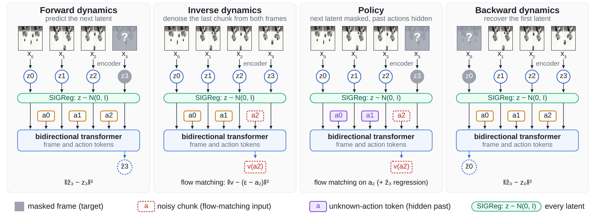
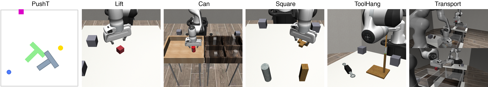
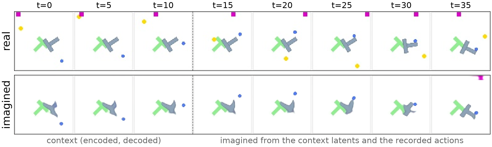
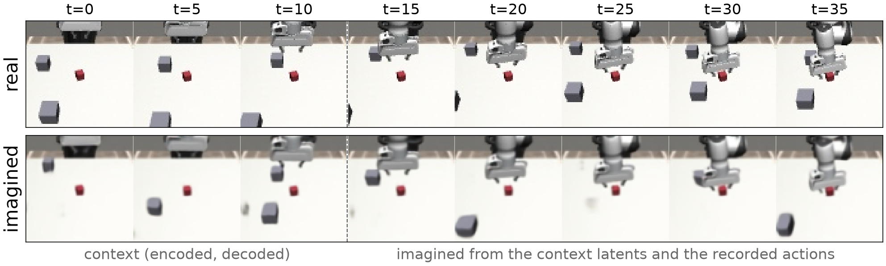
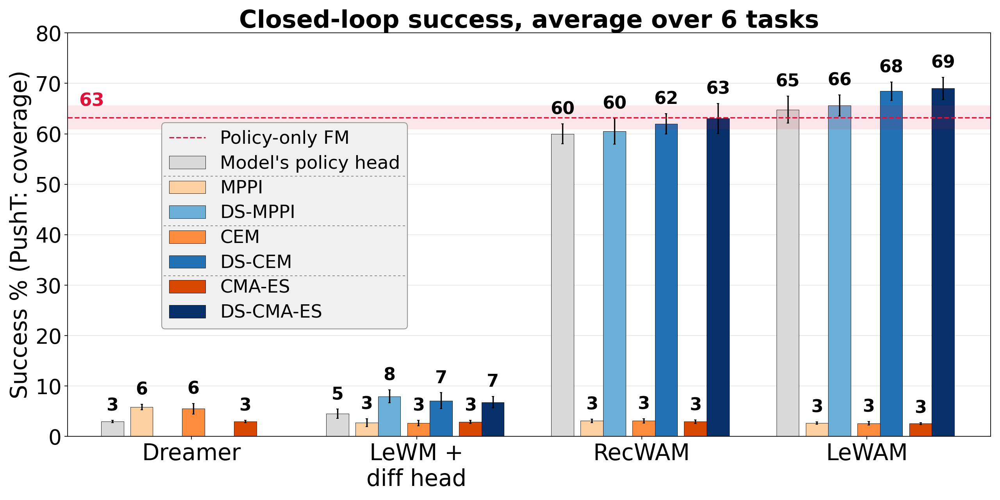
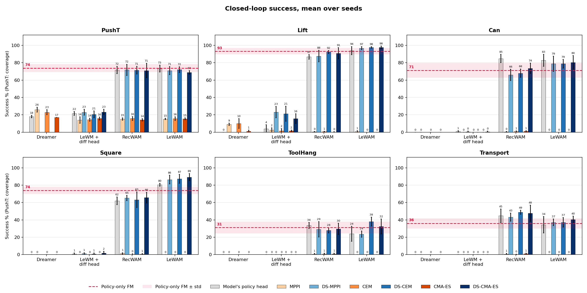

# LeWAM: JEPA 잠재 위의 월드액션모델과 노이즈 공간 MPC(Diffusion Steering)

아카이브 #4 · 2026-10-11 · arXiv 2610.12407v1 (2026-10-08 공개) · Shashank Hegde, Alexander Popov, Elie Aljalbout, Nikolai Smolyanskiy (NVIDIA) · 선정 이유: 아카이브 #3 TD-MPC2의 직접 후속 축이다. TD-MPC2가 "디코더 없는 잠재 + 샘플링 MPC"를 RL로 풀었다면, LeWAM은 같은 구조를 시연 데이터(모방학습) 위에서 JEPA로 세우고, 그 위에 flow-matching 정책 헤드를 얹은 뒤 **"학습된 다이나믹스 위에서 MPC가 왜 실패하고 어디서 샘플링해야 하는가"**를 분해한다. 이번 주 arXiv cs.RO에는 World Action Model(WAM) 신작이 한꺼번에 공개됐는데(Being-M0.7, MiniWAM, Long-WAM, UNITAS, PLaW-VLA, DreamTrue 등) 그중 이 논문이 ws0에서 직접 돌린 자체구현 JEPA(W1)·V-JEPA 2-AC CEM 계획·TD-MPC2 잠재 drift 실측과 가장 정확히 겹친다.

---

## 1. 한 줄 요약

**픽셀 디코더 없이 SIGReg로 붕괴를 막은 JEPA 잠재 위에, 입력 마스킹만 바꿔 forward·backward·inverse dynamics·정책 네 모드를 하나의 양방향 트랜스포머로 학습하는 41M 파라미터 월드액션모델. 그리고 이 모델로 계획할 때 원시 행동 대신 flow-matching 정책 헤드의 노이즈 $\epsilon$을 결정변수로 삼는 Diffusion Steering(DS)을 제안한다.** 선형 프로브로 읽히는 태스크 상태 $R^2$는 0.80(재구성 기반 WAM 0.78, forward 전용 JEPA인 LeWM 0.62)이면서 방해물 $R^2$는 0.00(재구성 WAM 0.73)이다. 폐루프 성공률은 정책 헤드만으로 6태스크 평균 65%(같은 인코더의 flow-matching 정책 단독 63%)이고, 행동 공간 MPC는 네 모델 모두 3%로 붕괴하는 반면 DS-CMA-ES는 69%까지 끌어올린다.

## 2. 문제 정의 — 세 가지 긴장

1. **재구성 기반 WAM의 용량 낭비.** UWM, Cosmos Policy처럼 사전학습 비디오 생성기 위에 행동 생성을 붙인 WAM은 잠재가 "디코더가 그려야 할 모든 픽셀"을 담아야 한다. 태스크와 무관한 방해물(흔들리는 상자, 움직이는 점)도 잠재를 차지하고, 그만큼 다이나믹스·행동 예측이 어려워진다.
2. **JEPA 월드모델의 반쪽짜리 구조.** DINO-WM, V-JEPA 2-AC, LeWM은 디코더를 버려 방해물에 강하지만 정책 헤드가 없다. 행동은 매번 CEM 같은 샘플링 계획으로 뽑아야 하므로 느리고, 추론 시 목표 잠재가 필요하다.
3. **학습된 다이나믹스 위 MPC의 악용 문제.** 데이터가 적을수록 forward 모델은 부정확하고 rollout에서 오차가 누적된다. 가우시안으로 원시 행동을 샘플링하는 MPC는 이 오차를 파고들어 "환상 속 미래"를 최적화한 행동을 내놓고, 실제 환경에서는 실패한다.

LeWAM은 1과 2를 "JEPA 잠재 + 멀티모드 백본 + flow 정책 헤드"로, 3을 "노이즈 공간 계획"으로 푼다. 원문 Table 1의 비교를 옮기면 다음과 같다.

| 모델 | 디코더 없음 | 행동 손실→인코더 | 정책 헤드 | forward | inverse | backward | 단일 백본 |
|---|---|---|---|---|---|---|---|
| Dreamer | – | – | ✓ | ✓ | – | – | – |
| TD-MPC2 | ✓ | – | ✓ | ✓ | – | – | – |
| DINO-WM / V-JEPA 2-AC | ✓ | – | – | ✓ | – | – | – |
| LeWM | ✓ | – | – | ✓ | – | – | – |
| UWM / Cosmos Policy | – | – | ✓ | ✓ | ✓ | – | ✓ |
| **LeWAM** | ✓ | ✓ | ✓ | ✓ | ✓ | ✓ | ✓ |

"행동 손실→인코더"는 flow-matching 행동 손실의 gradient가 인코더까지 흘러 잠재를 태스크 쪽으로 정렬시킨다는 뜻이다. LeWAM만 이 열이 ✓다.

## 3. 방법 — 수식 전개

### 3.1 입력과 표기

학습 윈도우는 frameskip 5로 뽑은 네 프레임 $o_{t-2:t+1}$과 그 사이의 5스텝 행동 청크 세 개 $a_{t-2:t}\in\mathbb R^{A}$다. 청크 차원 $A$는 5스텝 × 스텝당 행동 차원으로, PushT 10, robomimic 35, Transport(양팔) 70이며 차원별로 z-score 정규화한다. 앞 세 프레임의 잠재 $\mathbf z_t=(z_{t-2},z_{t-1},z_t)$가 문맥, 네 번째 프레임이 예측 타깃, 마지막 청크 $a_t$가 정책이 내야 할 행동이다. 관측은 픽셀뿐이고 proprioception·상태는 쓰지 않는다.

### 3.2 인코더와 SIGReg — EMA도 stop-gradient도 없이 붕괴를 막는다

각 프레임은 224px로 ViT-tiny/14(DINOv2-small 구조, 사전학습 가중치 없이 처음부터 학습)에 들어가고, [CLS] 토큰이 BatchNorm MLP 프로젝터를 거쳐 단일 벡터 $z_t\in\mathbb R^{384}$가 된다. 이 벡터 하나가 프로브가 읽고, 플래너가 비교하고, 다이나믹스가 회귀하는 유일한 표현이다.

JEPA의 고질병인 표현 붕괴(모든 입력이 같은 잠재로 수렴)를 LeWAM은 타깃 네트워크 없이 **SIGReg**(LeJEPA, Balestriero & LeCun 2025)로 막는다. 배치의 잠재 분포를 등방 가우시안 $\mathcal N(0,I)$로 밀어붙이는 정규화인데, 고차원 분포 검정을 1차원 투영 검정의 평균으로 바꾼 것이 핵심이다. $M$개의 랜덤 단위 방향 $\mathbf a_m$에 대해

$$\mathrm{SIGReg}(Z)=\frac{1}{M}\sum_{m=1}^{M} T\!\big(\{\mathbf a_m^{\top} z_n\}_{n=1}^{N}\big),\qquad \mathbf a_m\sim\mathrm{Unif}(\mathbb S^{d-1})$$

이고, 각 1차원 표본 $\{u_n\}$에는 Epps–Pulley 정규성 검정 통계량을 쓴다.

$$T(\{u_n\})=N\int_{-\infty}^{\infty}\Big|\hat\varphi(t)-e^{-t^{2}/2}\Big|^{2}\,w(t)\,dt,\qquad \hat\varphi(t)=\frac1N\sum_{n=1}^{N}e^{\,i\,t\,u_n}$$

경험적 특성함수 $\hat\varphi$와 표준정규의 특성함수 $e^{-t^2/2}$의 가중 $L^2$ 거리다. Cramér–Wold 정리에 의해 모든 1차원 투영이 $\mathcal N(0,1)$이면 결합분포는 $\mathcal N(0,I)$이므로, 투영을 충분히 뽑으면 등방 가우시안 제약이 된다. 적분은 고정 구간에서 수치 적분(LeWAM 설정: 17 knots, 1024 projections)으로 계산하고, 배치 크기에 선형이다. LeWAM은 이 항에 가중치 0.36(네 모드 × 0.09)을 둔다. 결과적으로 잠재는 **live 인코더 출력 그대로**를 forward 타깃으로 써도 붕괴하지 않는다. 이것이 BYOL 계열(EMA 타깃)이나 TD-MPC2(stop-gradient 타깃)와 다른 지점이다.

### 3.3 네 모드 — 마스킹이 모드를 정한다

백본은 깊이 8, 폭 512, 16헤드의 양방향 트랜스포머로, 프레임 잠재 토큰과 행동 토큰에 모달리티·프레임·$\sigma$ 임베딩을 더해 읽는다. 어떤 입력을 마스킹하느냐가 모드를 정한다.

**(i) Forward** — 마지막 프레임을 마스크 토큰으로 바꾸고, 모든 행동은 clean인 채 다음 잠재를 회귀한다.

$$\hat z_{t+1}=\hat f(\mathbf z_t,\,a_{t-2:t}),\qquad \mathcal L_{\mathrm{fwd}}=\big\lVert \hat z_{t+1}-z_{t+1}\big\rVert_2^{2}$$

**(ii) Backward** — 첫 프레임을 마스크하고 뒤 프레임들과 모든 행동에서 복원한다.

$$\hat z_{t-2}=\hat b(z_{t-1:t+1},\,a_{t-2:t}),\qquad \mathcal L_{\mathrm{bwd}}=\big\lVert \hat z_{t-2}-z_{t-2}\big\rVert_2^{2}$$

**(iii) Inverse** — 모든 프레임은 clean으로 두고 타깃 청크 $a_t$만 노이즈 샘플 $a_\sigma$로 바꿔 그 속도를 예측한다. 과거와 미래 상태를 잇는 행동을 추론하는 모드다.

$$\begin{aligned}\mathcal L_{\mathrm{inv}}=\mathbb E_{\sigma,\epsilon}\Big\lVert\;&v_\theta\big(a_\sigma,\sigma;\,z_{t-2:t+1},\,a_{t-2:t-1}\big)\\&-(\epsilon-a_t)\Big\rVert_2^{2}\end{aligned}$$

**(iv) Policy** — 마지막 잠재를 마스크하고 $a_t$를 노이즈 샘플로 바꾸며, 과거 행동 토큰 $a_{t-2:t-1}$은 학습된 unknown-action 토큰 $[\mathrm{unk}]$으로 가린다. 행동 생성과 잠재 회귀 두 손실이 동시에 걸린다.

$$\begin{aligned}\mathcal L_{\mathrm{pol}}=\;&\mathbb E_{\sigma,\epsilon}\Big\lVert v_\theta\big(a_\sigma,\sigma;\,\mathbf z_t,[\mathrm{unk}]\big)-(\epsilon-a_t)\Big\rVert_2^{2}\\&+\big\lVert \hat z_{t+1}-z_{t+1}\big\rVert_2^{2}\end{aligned}$$

여기서 $z_{t+1}$, $z_{t-2}$는 live 인코더 출력이다(EMA·stop-gradient 없음). Policy 모드에서 과거 행동을 가리는 이유는 정책이 시연자의 직전 동작을 베끼지 못하게 하기 위함이다. 네 모드는 **매 배치마다 전부** 실행된다. 인코더는 한 번만 돌고, 백본이 모드별로 독립 실행되며 손실을 합산한다. Forward·Backward가 SIGReg와 함께 JEPA 구조를 세우고, Inverse·Policy가 그 잠재를 태스크 쪽으로 정렬시킨다.

행동 생성은 rectified flow다. $\sigma\sim U(0,1)$, $\epsilon\sim\mathcal N(0,I)$에 대해

$$a_\sigma=(1-\sigma)\,a+\sigma\,\epsilon,\qquad \frac{d a_\sigma}{d\sigma}=\epsilon-a\;\;(\text{속도 타깃})$$

이므로 백본은 $v_\theta\approx\epsilon-a$를 회귀한다. 추론은 $\sigma=1$의 $\epsilon$에서 출발해 8번의 Euler 스텝($\Delta\sigma=1/8$)으로 $a_{\sigma-\Delta}=a_\sigma-\Delta\cdot v_\theta(a_\sigma,\sigma;\cdot)$를 반복해 $\sigma=0$의 행동 청크에 도달한다. 이 적분은 결정적 사상이고, 논문은 이를 $a=g(\epsilon;\mathbf z_t)$로 표기한다. **이 $g$가 §3.5의 계획 공간을 바꾸는 열쇠다.**

### 3.4 총 손실

원문 Table 5의 모드 가중치(forward 2, 나머지 1)와 SIGReg 가중치(0.36)를 그대로 쓰면

$$\mathcal L=2\,\mathcal L_{\mathrm{fwd}}+\mathcal L_{\mathrm{bwd}}+\mathcal L_{\mathrm{inv}}+\mathcal L_{\mathrm{pol}}+0.36\cdot\mathrm{SIGReg}(\{z\})$$

이다. 픽셀 디코더, 토크나이저, 픽셀·토큰 공간 손실이 하나도 없다. 잠재는 오직 "다이나믹스를 맞히는가"와 "행동을 생성하는가"로만 빚어진다.

### 3.5 계획 — 목표 잠재 거리와 행동 공간 MPC의 실패

DINO-WM·LeWM을 따라, 시연에서 가져온 목표 잠재 $z_g$와의 거리를 비용으로 쓴다.

$$\hat c(a)=\big\lVert \hat f(\mathbf z_t,a)-z_g\big\rVert_2 \tag{1}$$

$H$개 청크에 대해 샘플링 플래너가 $S$개 계획을 제안하고, 각 계획을 잠재 공간에서 굴린 최종 잠재로 점수를 매기고, 분포를 갱신하기를 $I$회 반복한 뒤 첫 청크만 실행하고 다시 계획한다(MPC). 갱신 규칙이 플래너를 정한다. CEM은 상위 $K$개 elite로 가우시안을 다시 맞추고, MPPI는 비용의 softmax 가중 평균을 취하며, CMA-ES는 공분산과 스텝 크기를 적응시킨다. 고전적 MPC의 결정변수는 원시 행동 시퀀스 $a_{1:H}\in\mathbb R^{AH}$다.

문제는 §2의 3번이다. LeWM 원 논문에서는 행동 공간 CEM이 동작했지만, 여기서 다루는 200개 시연 규모의 사람 데이터에서는 네 모델 모두 3~8% 성공률로 무너진다(Figure 5). 저자들의 가설은 명확하다. 데이터가 적어 forward 모델이 부정확하고, rollout에서 오차가 복리로 쌓이며, 가우시안 행동 샘플링은 그 오차를 **악용**해 환상의 미래를 최적화한다는 것이다.

### 3.6 Diffusion Steering — 결정변수를 행동에서 노이즈로

flow-matching WAM에는 일반 월드모델에 없는 것이 있다. 가우시안 노이즈 $\epsilon\in\mathbb R^{A}$를 청크로 보내는 **결정적 사상 $g(\cdot;\mathbf z)$**다. DS는 임의의 샘플링 플래너의 결정변수를 행동 $a_{1:H}$에서 이 노이즈 $\epsilon_{1:H}$로 옮긴다. 청크 $h$는 앞선 $1..h-1$ 청크를 실행한 뒤 **상상된 상태**에서 디코딩된다.

$$\begin{aligned}a_h&=g\big(\epsilon_h;\,\hat{\mathbf z}_{h-1}\big), & \hat z_h&=\hat f\big(\hat{\mathbf z}_{h-1},a_h\big),\\ \hat{\mathbf z}_h&=\mathrm{shift}\big(\hat{\mathbf z}_{h-1},\hat z_h\big), & \hat{\mathbf z}_0&=\mathbf z_t\end{aligned}\tag{2}$$

$\mathrm{shift}$는 가장 오래된 문맥 잠재를 버리고 예측 잠재를 붙이는 연산이다. 계획의 점수는 식 (1)을 최종 잠재 $\hat z_H$에 적용한 값이다. 탐색은 정책의 사전분포 $\mathcal N(0,I)$에서 시작하므로, **모든 DS 플래너의 첫 반복은 $N=S$개 정책 샘플 중 best-of-$N$ 순위 매기기와 같다.** 이후 반복이 그 분포를 좁혀 간다. DS-CEM, DS-MPPI, DS-CMA-ES는 같은 예산(64샘플 × 3반복, 지평 5청크 = 환경 25스텝, elite 8)을 쓰고 갱신 규칙만 다르다.

왜 이것이 악용을 막는가. 행동 공간 탐색은 다이나믹스 모델이 한 번도 본 적 없는 행동(시연 분포 밖)까지 자유롭게 제안할 수 있고, 모델은 그런 입력에 대해 임의의 낙관적 잠재를 내놓는다. 반면 $g$를 거친 행동은 정책 헤드가 시연에서 배운 분포 안에 있다. 탐색이 "월드모델의 상상 안에서, 정책의 지지집합 위에서만" 일어난다.

### 3.7 전형 집합으로의 투영 — $\sqrt A$ 구면

한 가지 함정이 남는다. 헤드는 $\mathcal N(0,I_A)$에서 뽑은 $\epsilon$으로만 학습됐는데, $\lVert\epsilon\rVert^2\sim\chi^2_A$이므로 그 표본은 평균 $A$, 표준편차 $\sqrt{2A}$로 **반지름 $\sqrt A$의 구면 근처에 집중**한다($A=35$면 $\lVert\epsilon\rVert\approx5.9$, 상대 산포 약 12%). CEM이 elite 평균 쪽으로 분포를 좁히면 제안의 노름이 급격히 작아지고, rectified-flow 헤드에게 작은 노름의 $\epsilon$은 **온도를 낮춘 샘플링(mode-seeking)**과 같아 학습 분포 밖 입력이 된다. Projected DS는 디코딩 직전에 모든 제안을 구면으로 되돌린다.

$$\epsilon\leftarrow\sqrt{A}\,\frac{\epsilon}{\lVert\epsilon\rVert}$$

그 결과 탐색은 **방향**에 대해서만 이루어지고, 디코딩되는 모든 후보는 헤드가 생성하도록 훈련된 것이며, 온도 효과는 포기한다. 탐색 분포 자체는 유클리드 공간에 그대로 두고 제안만 투영한다. 이 한 줄의 효과는 Table 4에 나온다(Can에서 23% → 78.8%).

> **Algorithm 1 — 샘플링 플래너 $\mathcal P$의 Diffusion Steering (한 번의 의사결정)**  
> 입력: 문맥 $\mathbf z_t$, 목표 $z_g$, 지평 $H$, 샘플 $S$, 반복 $I$, 정책 사상 $g$, forward $\hat f$, 플래너 $\mathcal P$ = (propose, update, select)  
> $\theta\leftarrow$ 정책 사전분포 $\mathcal N(0,I)$ ($\epsilon_{1:H}$에 대해)  
> **for** $i=1..I$:  
>  $\epsilon^{(1:S)}_{1:H}\leftarrow\mathrm{propose}(\theta)$  
>  $\epsilon^{(s)}_h\leftarrow\sqrt A\,\epsilon^{(s)}_h/\lVert\epsilon^{(s)}_h\rVert$ — 모든 $s,h$에 대해 전형 집합으로 투영  
>  **for** $s=1..S$:  
>   $\hat{\mathbf z}\leftarrow\mathbf z_t$  
>   **for** $h=1..H$:  
>    $a^{(s)}_h\leftarrow g(\epsilon^{(s)}_h;\hat{\mathbf z})$ — 상상된 상태에서 디코딩(8 Euler 스텝)  
>    $\hat z\leftarrow\hat f(\hat{\mathbf z},a^{(s)}_h)$, $\hat{\mathbf z}\leftarrow\mathrm{shift}(\hat{\mathbf z},\hat z)$  
>   $c^{(s)}\leftarrow\lVert\hat z-z_g\rVert$  
>  $\theta\leftarrow\mathrm{update}(\theta,\epsilon^{(1:S)},c^{(1:S)})$ — CEM: elite 가우시안 refit / MPPI: softmax 가중 평균 / CMA-ES: 공분산·스텝 적응  
> **return** $\mathrm{select}(\theta,\epsilon^{(1:S)},c^{(1:S)})$의 첫 청크를 $\mathbf z_t$에서 디코딩  

비용 감각(원문에 명시된 수치는 아니고 설정에서 계산한 추정): 한 번의 의사결정에 청크 디코딩 $S\cdot I\cdot H=960$회, 각각 Euler 8스텝이므로 백본 호출 약 7,680회에 forward 960회가 더해진다. $S$는 배치로 처리되므로 순차 깊이는 $I\cdot H\cdot 9=135$회다. 저자들도 "계획이 느리다"를 한계로 명시한다.

### 3.8 TD-MPC2와 무엇이 다른가 (아카이브 #3 대조)

| 항목 | TD-MPC2 | LeWAM |
|---|---|---|
| 학습 신호 | 보상·TD 가치 (온라인 RL) | 시연의 행동 (모방), 보상 없음 |
| 잠재 안정화 | SimNorm + stop-gradient 타깃 | SIGReg, live 타깃 |
| 계획 비용 | $\sum\gamma^h R+\gamma^H Q$ (학습된 가치) | $\lVert\hat z_H-z_g\rVert$ (목표 잠재 거리) |
| 지평 | $H=3$ 스텝 | 5청크 = 25 환경 스텝 |
| 정책 prior의 역할 | 512 샘플 중 24개만 prior rollout | **100% 정책의 노이즈 공간**에서 샘플 |
| 결정변수 | 행동 $a_{t:t+H}$ | 노이즈 $\epsilon_{1:H}$ (구면 투영) |

TD-MPC2가 짧은 지평과 가치 부트스트랩으로 모델 오차의 영향을 제한했다면, LeWAM은 탐색 공간 자체를 정책의 지지집합으로 좁혀 오차 악용을 막는다. 두 설계는 같은 병(학습된 모델의 오차를 플래너가 파고듦)에 대한 다른 처방이다.

## 4. 피겨와 해설

*Figure 1 (원문): 한 윈도우에서 마스킹으로 구분되는 네 모드. Forward는 마지막 잠재를 마스크하고 $\lVert\hat z_3-z_3\rVert^2$, Inverse는 모든 프레임을 두고 마지막 청크를 flow-matching으로 디노이즈, Policy는 마지막 잠재 마스크 + 과거 행동을 unknown 토큰으로 숨긴 채 행동 생성과 잠재 회귀를 동시에, Backward는 첫 잠재를 복원. 모든 잠재에 SIGReg($z\sim\mathcal N(0,I)$)가 걸리고, 픽셀로 디코딩되는 것은 없다.*

*Figure 2 (원문): 프레임마다 공유 ViT-tiny/14 → 프로젝터 → 384차원 [CLS] 잠재 하나. 깊이 8·폭 512·16헤드 양방향 트랜스포머가 프레임 잠재 4개와 행동 청크 3개를 읽고, latent head(월드모델: 후보 청크를 $\lVert\hat z-z_{goal}\rVert^2$로 채점)와 action head(정책: 노이즈 $\epsilon$에서 청크 샘플, DS 플래너는 이 $\epsilon$을 탐색)로 갈라진다.*

*Figure 3 (원문 6장 합성): 모델이 보는 그대로의 입력. PushT에는 Lissajous 곡선을 도는 점과 상단을 미끄러지는 막대를 그려 넣었고, robomimic 다섯 태스크에는 태스크 물체보다 큰 회색 상자 두 개가 다이나믹스에 영향 없이 흔들린다. 관측은 이 픽셀뿐이고 proprioception은 없다.*

*Figure 4 상단 (원문): 학습이 끝난 LeWAM을 고정한 채 별도 컨볼루션 디코더만 학습해 잠재를 시각화. 앞 3프레임은 문맥, 뒤 5프레임은 forward 모드를 GT 행동으로 굴린 상상. T 블록의 위치는 일관되게 맞지만 회전은 흐릿하고, 노란 점·자홍 막대 방해물은 상상에서 거의 사라진다. 잠재가 방해물을 버렸다는 선형 프로브 결과의 시각적 확인이다.*

*Figure 4 하단 (원문): Lift 태스크. 그리퍼와 빨간 큐브의 접근은 상상에서 재현되지만 회색 방해물 상자는 없거나 엉뚱한 위치에 나타난다. 저자들은 엉뚱한 위치의 상자를 디코더의 환각으로 해석한다(잠재에는 정보가 없는데 디코더가 그려 넣음).*

*Figure 5 (원문): 6태스크 평균, 5학습 시드 × 50평가 = 250 rollout. 빨간 점선은 같은 인코더의 flow-matching 정책 단독(63%). Dreamer 3%, LeWM+diffusion head 5%, RecWAM 60%, LeWAM 65%. 행동 공간 MPPI/CEM/CMA-ES(주황 계열)는 네 모델 모두 3%로 붕괴한다. 노이즈 공간 DS(파랑 계열)는 RecWAM을 60→63, LeWAM을 65→66(DS-MPPI)/68(DS-CEM)/69(DS-CMA-ES)로 올린다.*

*Figure 6 (원문 부록): 태스크별 분해. LeWAM 정책 헤드는 Lift 94·Can 83·Square 80으로 참조 정책(93·71·74)을 넘고, DS-CEM/CMA-ES는 Lift 98, Square 87~89, Transport 37~40까지 더 올린다. ToolHang(24, 참조 31)과 Transport(34, 참조 36)는 정책 단독으로는 참조에 못 미치고 DS로 겨우 따라잡는다. 행동 공간 MPC의 0~1%가 모든 패널에서 반복된다.*

## 5. 실험 결과 — 핵심 숫자

- **설정**: PushT(사람 시연 206개, 10Hz 절대 위치 행동) + robomimic Lift·Can·Square·ToolHang·Transport(proficient-human 200개씩, robosuite 재생). 90% 학습, 10% 평가, 방해물 포함. 300 epoch, batch 128, AdamW(lr $5\times10^{-5}$, wd $10^{-3}$), bf16, grad clip 1.0, 5 시드. 모든 모델을 약 41M 학습 파라미터로 맞춤(LeWAM 41.0M, LeWM 42.2M, RecWAM 42.6M + 3.9M VAE, Dreamer 43.4M). **하이퍼파라미터는 robomimic 다섯 태스크에 단일 설정.**
- **선형 프로브(Table 2, 6태스크 평균, ridge + 5-fold CV)**: 태스크 상태 $R^2$ — Dreamer 0.68, LeWM+head 0.62, RecWAM 0.78, **LeWAM 0.80**. 방해물 $R^2$ — Dreamer 0.19, LeWM 0.00, RecWAM **0.73**, LeWAM **0.00**. 즉 재구성 WAM은 상태를 잘 읽지만 방해물도 똑같이 잘 읽고(용량 낭비의 직접 증거), LeWAM은 상태만 읽는다. 단, Lift에서는 RecWAM 0.56 > LeWAM 0.42로 역전된다.
- **폐루프(Figure 5)**: 참조 63 / LeWAM 정책 65 / DS-CMA-ES **69**. 행동 공간 MPC는 3. "월드모델을 공짜로 얻으면서 정책 성능은 유지"가 Acting 주장의 실체다.
- **모드 절제(Table 3, 41M, 50 에피소드/셀)**: Lift — 네 모드 $R^2$ 0.423 / 정책 94.0 / DS-CEM 97.6, forward 제거 시 0.323 / 91.6 / 95.6, **정책 모드 제거 시 DS-CEM 0.8**(inverse 헤드를 조향해도 안 됨). Can — 네 모드 0.839 / 82.8 / 78.8, 정책 제거 0.0. Square — 네 모드 0.896 / 80.4 / 87.2, forward 제거 0.876 / 71.2 / 73.6, inverse 제거는 정책 82.0으로 중립. Forward와 Backward는 일관되게 기여하고, 정책 모드 없이는 계획 자체가 성립하지 않는다.
- **투영 절제(Table 4, DS-CEM)**: $\sqrt A$ 구면 투영 유/무 — Lift 97.6 / 93.0, **Can 78.8 / 23.0**, Square 87.2 / 75.0. 한 줄 정규화가 Can에서 56포인트를 좌우한다.
- **계획 예산(공통)**: 64 샘플, 3 반복, 8 elite, 지평 5청크. 목표는 현재 잠재에 가장 가까운 시연 프레임의 25스텝 뒤 관측을 각 모델의 잠재로 인코딩한 것.

## 6. 한계

- **시뮬레이션 + 인공 방해물뿐이다.** 실제 영상의 "동역학적으로 무관한 특징"(조명, 배경 사람, 반사)은 이보다 훨씬 다양하다. 저자들이 첫 번째 후속 과제로 명시.
- **DS는 추론 시 목표 잠재가 필요하다.** 시연에서 가장 가까운 프레임을 찾아 25스텝 뒤를 목표로 쓰므로, 배포 환경에 시연 데이터베이스가 있어야 하고 "가까운 시연이 없는" 상황은 다루지 않는다. 언어 조건도 없다(WAM이지 VLA가 아니다).
- **계획이 느리다.** §3.7의 추정대로 의사결정당 수천 번의 백본 호출이 들어간다. 평균 +4포인트(65→69)를 위한 비용이며, 실시간 제어와는 거리가 있다.
- **이득의 크기가 작고 분산 안에 있는 태스크가 있다.** Can은 정책 83 vs DS 79~80으로 오히려 내려가고, PushT도 73 vs 69~72다. "DS가 항상 좋다"가 아니라 "행동 공간 MPC는 항상 나쁘고, DS는 정책을 해치지 않으면서 가끔 올린다"가 정확한 독해다.
- **인코더를 처음부터 학습**하므로 DINOv2·V-JEPA 2 같은 사전학습 표현의 이점을 쓰지 않는다. 200개 시연 규모에서 성립한 결론이 대규모 사전학습 WAM(Cosmos Policy급)에서도 유지되는지는 열려 있다.
- 비교 대상 Dreamer·LeWM·RecWAM이 모두 저자 재구현이고 41M으로 맞춰졌다. 원 논문 설정과 다르므로 "Dreamer 3%"를 Dreamer 일반의 성능으로 읽으면 안 된다.

## 7. 내 작업과의 연결

- **"자체구현 JEPA(W1)와 정확히 같은 평가, 다른 붕괴 방지법."** ws0에서 ViT-tiny 인코더 + predictor를 직접 짜서 feature-space 예측기를 학습했고(1.29M, 8-step latent-MSE ≈ 0.002, frozen 잠재→카메라 pose 선형 프로브 $R^2\approx0.92$, depth 0.90), 붕괴는 **EMA 타깃 + stop-gradient**로 막았다. LeWAM/LeWM은 그 자리에 SIGReg를 넣고 live 타깃을 쓴다. Table 2의 ridge 프로브 $R^2$는 내가 쓴 것과 동일한 지표라 바로 비교 가능하다. 구체적 다음 실험: W1 코드에서 EMA를 떼고 SIGReg(1024 투영, Epps–Pulley 17 knots, 가중치 0.1~0.36)로 교체해 eff-rank·프로브 $R^2$·학습 안정성을 같은 시퀀스에서 재측정. 하이퍼파라미터가 EMA 모멘텀·타깃 스케줄에서 $\lambda$ 하나로 줄어드는지가 확인 포인트다.
- **"V-JEPA 2-AC에서 내가 돌린 것이 바로 식 (1)의 행동 공간 CEM이다."** ViT-g 1.3B 체크포인트로 Franka 궤적의 energy landscape를 뒤집고 CEM으로 행동을 찾았을 때 GT 행동 에너지 0.048, 무행동 0.129, CEM 해 0.056을 얻었다. 그때는 행동 공간 CEM이 동작했는데, LeWAM은 41M·200시연에서 같은 방식이 3%로 붕괴한다고 보고한다. 차이는 모델 규모·사전학습 유무·단일 스텝 목표 vs 5청크 rollout이다. 즉 "행동 공간 MPC가 되느냐"는 다이나믹스 모델의 정확도와 지평의 함수이고, 내 두 실측(V-JEPA 2-AC에서 됨, TD-MPC2 drift h1 $2.9\times10^{-5}$ → h30 $6.7\times10^{-3}$)이 그 양 끝을 짚고 있다. LeWAM의 DS는 모델이 부정확할 때의 처방이다.
- **"재구성 vs 비재구성 축을 내 벤치에 방해물만 추가하면 직접 검증할 수 있다."** 같은 MuJoCo GT 시퀀스 위에서 W2 RSSM(픽셀 디코딩, drift 거의 없음)과 W3 diffusion(AR 30.6→22.1dB drift)과 W1 JEPA를 비교했지만 장면이 정적이라 "재구성이 방해물에 용량을 낭비한다"는 주장은 시험하지 못했다. LeWAM처럼 다이나믹스와 무관하게 움직이는 물체를 렌더에 넣고 세 모델의 잠재에 방해물 프로브 $R^2$를 재면, Table 2의 0.73 vs 0.00 대비를 내 데이터로 재현하는 것이 된다. 실무에서 3DGS 씬을 다뤘으므로 방해물 삽입 렌더는 익숙한 작업이다.
- **"노이즈 공간 조향은 flow-matching 정책이면 어디든 붙는 추론 전용 기법이다."** 아카이브 #1 π0의 action expert, OpenVLA 계열의 연속 행동 헤드 모두 $\epsilon\to a$ 결정적 사상을 갖는다. 월드모델 없이도 best-of-$N$ + $\sqrt A$ 투영만으로 첫 반복은 성립하므로, 내가 LoRA로 파인튜닝한 VLA에 "학습 없이 추론에서 올릴 수 있는 것"의 후보로 기록해 둔다. 단, 채점 함수(목표 잠재 거리 또는 가치)가 필요하다는 전제는 그대로다.

## 8. 30초 요약 카드

> **LeWAM (NVIDIA, arXiv 2610.12407, 2026-10)** — 처음부터 학습한 ViT-tiny의 384차원 [CLS] 잠재에 SIGReg(랜덤 투영 + Epps–Pulley 검정으로 $\mathcal N(0,I)$ 강제, EMA·stop-grad 없음)를 걸고, 양방향 트랜스포머 하나가 마스킹으로 forward·backward·inverse·policy 네 모드를 매 배치 학습하는 41M 월드액션모델. 행동은 rectified flow 8 Euler 스텝 $a=g(\epsilon;\mathbf z)$. **계획은 행동이 아니라 $\epsilon$ 공간에서**(Diffusion Steering) 하고 제안을 $\sqrt A$ 구면에 투영해 헤드의 학습 분포 안에 머문다. 숫자: 상태 프로브 $R^2$ 0.80 / 방해물 0.00(재구성 WAM 0.78 / 0.73), 폐루프 평균 정책 65% → DS-CMA-ES 69%(참조 63%), 행동 공간 MPC는 전 모델 3%, 투영 제거 시 Can 78.8→23.0. 한계: 시뮬 전용, 추론 시 목표 잠재 필요, 계획 느림, 이득 소폭. 내 연결: W1 JEPA의 EMA를 SIGReg로 교체 실험, V-JEPA 2-AC 행동 공간 CEM 성공 vs 여기서의 붕괴 대비, 내 벤치에 방해물 추가로 재구성 축 검증.

---

*피겨 출처: Hegde, Popov, Aljalbout, Smolyanskiy, "LeWAM: A JEPA World Action Model with Diffusion-Steering-Based MPC", arXiv 2610.12407 (CC BY 4.0). SIGReg 정의는 Balestriero & LeCun, "LeJEPA", arXiv 2511.08544 및 Maes 외, "LeWorldModel", arXiv 2603.19312 기준. 개인 학습용 아카이브.*
