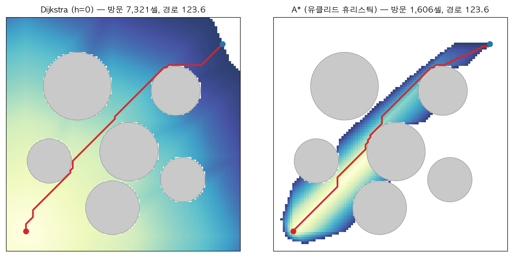
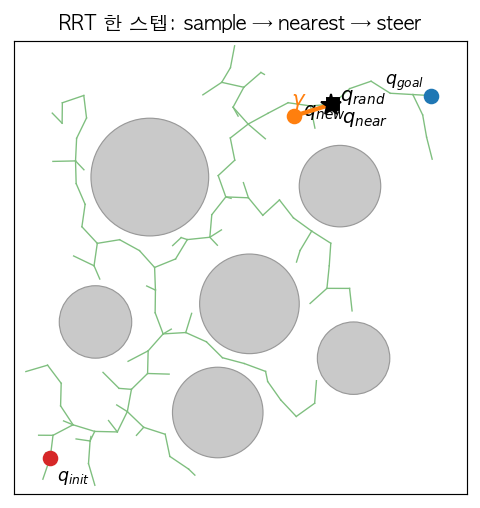
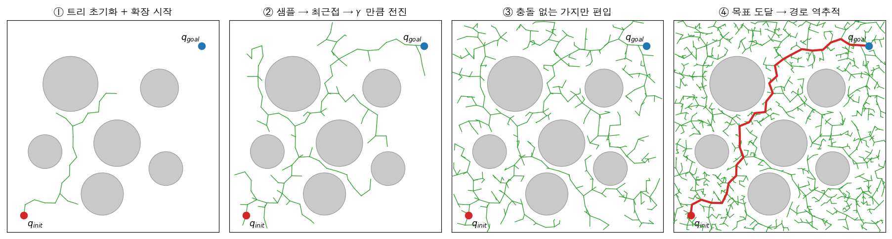
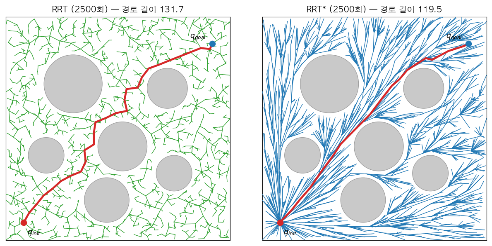
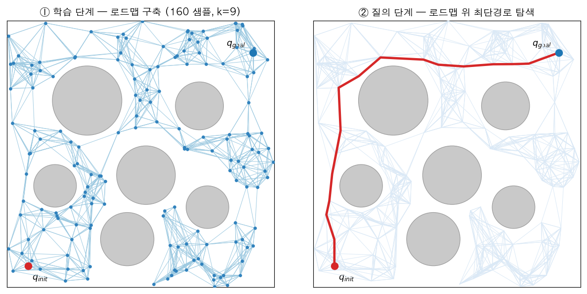

# Motion Planning — 그래프 탐색 · 샘플링 · 최적화

[perception](perception.md) → [manipulation](manipulation.md) 파이프라인에서 우리는 pick 타겟까지의 이동을 **IK 해를 조인트 공간 웨이포인트로 보간해 순차 실행**하는 것으로 처리했다. 이것은 정확히 말하면 플래닝이 아니라 **실행(execution)** 이다 — 충돌 회피를 명시적으로 풀지 않았기 때문이다. 이 페이지는 그 빈 층, **"시작 자세에서 목표 자세까지 충돌 없는 경로를 어떻게 찾는가"** 를 알고리즘 계보별로 정리한다. 모든 그림은 이 페이지를 위해 직접 구현해 돌린 결과다(§8 구현 노트).

## 1. 문제 정의 — Configuration Space

모션 플래닝의 표준 정식화는 작업 공간(workspace)이 아니라 **configuration space(C-space)** 에서 한다.

- **configuration $q$**: 로봇의 자세를 완전히 결정하는 최소 좌표 — 6축 팔이면 $q \in \mathbb{R}^6$(관절각), 평면 모바일 로봇이면 $(x, y, \theta)$.
- **$C_{free}$ / $C_{obs}$**: 로봇이 어떤 장애물과도 겹치지 않는 configuration의 집합 / 그 여집합. 작업 공간의 장애물 하나가 C-space에서는 복잡한 모양의 $C_{obs}$ 로 변형된다 — **$C_{obs}$ 를 명시적으로 계산하는 것은 일반적으로 불가능**하고, 할 수 있는 것은 "주어진 $q$ 가 충돌인가"라는 **멤버십 질의(충돌 체크)** 뿐이다. 이 사실이 아래 모든 알고리즘 설계를 지배한다.
- **문제**: $q_{init}, q_{goal} \in C_{free}$ 가 주어졌을 때, $C_{free}$ 안에서 둘을 잇는 연속 경로를 찾아라.

해의 품질을 말하는 어휘 세 가지:

| 성질 | 뜻 |
|---|---|
| **완전성(complete)** | 해가 존재하면 반드시 찾고, 없으면 없다고 보고 — 일반 C-space에선 계산적으로 비현실적 |
| **해상도 완전성(resolution complete)** | 이산화 해상도 한에서 완전 — 그리드 탐색 계열 |
| **확률적 완전성(probabilistically complete)** | 샘플 수 $\to\infty$ 이면 해를 찾을 확률 $\to 1$ — 샘플링 계열 |
| **점근 최적성(asymptotically optimal)** | 샘플 수 $\to\infty$ 이면 경로 비용이 최적값으로 수렴 — RRT*·PRM* |

계보는 셋이다: **그래프 탐색**(공간을 미리 이산화) · **샘플링**(공간을 무작위로 탐침) · **최적화**(초기 궤적을 다듬기). 차례로 본다.

## 2. 그래프 탐색 계열 — Dijkstra와 A*

공간을 그리드(또는 격자 그래프)로 이산화할 수 있으면, 플래닝은 최단경로 문제가 된다.

- **Dijkstra**: 시작점에서의 실제 비용 $g(n)$ 이 작은 노드부터 우선순위 큐로 확장. 최적 보장, 그러나 **모든 방향으로 균일하게 퍼진다** — 목표가 어디인지 모르는 탐색.
- **A***: 확장 순서를 $f(n) = g(n) + h(n)$ 으로 바꾼다. $h(n)$ 은 목표까지의 추정 비용(휴리스틱).
  - **admissible**($h$ 가 실제 잔여 비용을 절대 과대평가하지 않음)이면 **최적 경로를 보장**한다. 유클리드 거리가 대표적 — 직선보다 짧은 경로는 없으므로.
  - **consistent**($h(n) \le c(n,n') + h(n')$, 삼각부등식)이면 노드 재확장이 없어 효율까지 보장.
  - 직관: $h$ 는 탐색을 목표 쪽으로 **조준하는 조준경**이고, admissibility는 "조준이 공격적이어도 거짓말은 아니다"라는 보증이다.

직접 돌려 본 결과 — 같은 100×100 그리드, 같은 장애물, 8-연결:

**방문 셀 7,321 → 1,606 (4.6배 절감), 경로 길이는 123.6으로 동일.** 색은 방문 순서다 — Dijkstra는 동심원처럼 퍼지고, A*는 목표 방향 회랑만 태운다. admissible 휴리스틱의 정의("효율은 얻고 최적성은 잃지 않는다")가 그림 한 장으로 끝난다.

변형 계보 한 줄씩: **Weighted A***($f = g + \varepsilon h$, $\varepsilon>1$) — 최적성을 $\varepsilon$배 한도로 팔아 속도를 사는 것. **Anytime(ARA*)** — 큰 $\varepsilon$로 빨리 찾고 시간이 남으면 줄여가며 개선. **D* / D* Lite** — 지도가 바뀔 때(이동 중 장애물 발견) 전체 재탐색 없이 증분 수정 — 모바일 로봇 내비게이션의 고전.

**언제 쓰나**: 2~3차원(모바일 로봇 평면 내비, 그리드 지도)에선 그래프 탐색이 표준이다. 문제는 차원이다 — 6축 팔의 C-space를 축당 100칸으로 이산화하면 $100^6 = 10^{12}$ 셀. **차원의 저주가 그래프 탐색을 고차원에서 죽이고, 그 자리에 샘플링 계열이 들어온다.**

## 3. 샘플링 계열 ① — RRT

**RRT(Rapidly-exploring Random Tree, LaValle 1998)** 는 공간을 이산화하는 대신 **무작위 샘플로 탐침하면서 트리를 키운다**. 한 반복은 네 단계다:

1. **샘플**: $q_{rand}$ 를 C-space에서 균일 추출 (일정 확률로 $q_{goal}$ 을 뽑는 **goal bias** 를 섞는다)
2. **최근접**: 트리에서 $q_{rand}$ 에 가장 가까운 노드 $q_{near}$ 를 찾는다
3. **스티어(steer)**: $q_{near}$ 에서 $q_{rand}$ 방향으로 **스텝 크기 $\gamma$ 만큼만** 전진한 점을 $q_{new}$ 로 한다
4. **충돌 체크 후 편입**: $q_{near} \to q_{new}$ 선분이 $C_{free}$ 에 있으면 트리에 추가. 목표 근방에 닿으면 부모 포인터를 역추적해 경로 완성

왜 "rapidly-exploring"인가 — **Voronoi 편향**: 균일 샘플의 최근접 노드가 될 확률은 각 노드의 Voronoi 영역 넓이에 비례하는데, 미탐사 영역과 접한 경계 노드일수록 영역이 넓다. 즉 **아무 설계 없이도 트리가 빈 공간 쪽으로 끌려간다.** 위 성장 그림에서 트리가 초반에 사방으로 뻗는 이유다.

성질과 한계:

- 확률적 완전성 보장. 그러나 **최적성은 전혀 없다** — 찾은 경로는 지그재그이고, 반복을 늘려도 더 좋아지지 않는다(아래 §4 그림의 왼쪽).
- 파라미터는 사실상 둘: 스텝 $\gamma$(크면 빠르되 좁은 틈을 못 지나감), goal bias(크면 탐욕적 — 국소 함정).
- **RRT-Connect**: 시작·목표 양쪽에서 트리 두 개를 키워 서로를 향해 연결 — 단일 질의 실무에서 가장 흔한 고속 변형(OMPL 기본값 계열).

## 4. 샘플링 계열 ② — RRT*

**RRT*(Karaman & Frazzoli 2011)** 는 RRT의 반복에 두 단계를 더해 **점근 최적성**을 얻는다. $q_{new}$ 주변 반경 $r$ 의 이웃 노드들에 대해:

1. **부모 선택(choose parent)**: $q_{near}$ 가 아니라, 이웃 중 **시작점부터의 누적 비용 $g$ 가 최소가 되는 노드**를 부모로 연결한다.
2. **재배선(rewire)**: 거꾸로, $q_{new}$ 를 경유하면 비용이 줄어드는 이웃이 있으면 **그 이웃의 부모를 $q_{new}$ 로 바꿔 단다.**

즉 트리가 자라면서 **과거의 연결을 계속 수선**한다. 반경을 $r \propto (\log n / n)^{1/d}$ 로 줄여가면 추가 비용은 로그 수준이면서 비용이 최적값으로 수렴한다는 것이 원 논문의 결과다.

같은 시드, 같은 2,500회 반복으로 직접 비교한 결과:

**경로 길이 131.7 → 119.5.** 그림이 성격 차이를 그대로 보여준다 — RRT 트리는 덤불이고, RRT* 트리는 시작점에서 뻗는 **부챗살**이다(모든 노드가 "시작점까지 거의 최단"으로 재배선된 결과). 경로도 지그재그가 펴져 장애물 사이를 거의 직선으로 지난다.

후속 한 줄씩: **Informed RRT*** — 현재 최선 경로 길이를 장축으로 하는 타원 안에서만 샘플링(그 밖의 샘플은 해를 개선할 수 없음이 기하적으로 보장됨). **BIT*** — 샘플 배치를 배치 단위로 받고 A*식 탐색 순서를 결합.

## 5. 샘플링 계열 ③ — PRM

RRT가 "이번 질의 하나"를 푸는 트리라면, **PRM(Probabilistic Roadmap, Kavraki 1996)** 은 **같은 환경에서 질의가 여러 번** 올 때를 위한 그래프다. 두 단계로 나뉜다:

1. **학습 단계(offline)**: $C_{free}$ 에서 $n$ 개를 샘플하고, 각 샘플을 $k$-최근접 이웃과 충돌 없는 선분으로 연결해 **로드맵**을 만든다.
2. **질의 단계(online)**: $q_{init}, q_{goal}$ 을 로드맵에 접속시킨 뒤, 로드맵 위에서 **그래프 최단경로(Dijkstra/A*)** 를 푼다 — §2가 여기서 재등장한다.

- 멀티 질의 상황(고정된 셀 안의 로봇 팔이 수백 번 다른 목표로 움직이는 공장 셋업)에서 로드맵 구축 비용이 상각된다. 환경이 바뀌면 로드맵이 무효화되는 것이 약점.
- **좁은 통로(narrow passage) 문제**: 균일 샘플링은 부피가 작은 통로에 샘플을 거의 못 떨어뜨린다 — PRM 계열의 고전적 약점이고, 가우시안/브리지 샘플링 같은 편향 샘플링이 이를 겨냥한다.
- **PRM***: RRT*와 같은 논문에서, 연결 반경/이웃 수를 $n$ 에 맞춰 조절하면 점근 최적.

## 6. 최적화 계열 — 경로를 "찾는" 게 아니라 "다듬는" 접근

세 번째 계보는 초기 궤적(직선이어도 됨)에서 출발해 **비용함수를 내리며 변형**한다:

$$U(\xi) = U_{smooth}(\xi) + \lambda\, U_{obs}(\xi)$$

- **CHOMP**: 부드러움(속도/가속도 제곱 적분) + 장애물 비용(거리장 기반)을 궤적 전체에 대해 경사하강. 공분산 기하를 고려한 함수적 경사가 핵심.
- **STOMP**: 경사 대신 **확률적 샘플 궤적들의 가중 평균**으로 업데이트 — 미분 불가능한 비용도 다룸.
- **TrajOpt**: 축차 이차계획(SQP) + 충돌 제약의 선형화 — 제약 조건(자세 유지, 토크 한계)을 명시적으로 넣기 좋다.

성격: 해가 **국소 최적**이다 — 초기 궤적이 장애물 "반대편 골짜기"에 있으면 못 넘어간다. 그래서 실무 표준 조합은 **샘플링으로 위상적으로 올바른 경로를 찾고 → 최적화로 다듬기**다. 다듬기의 가장 값싼 형태가 **shortcutting**(경로 위 두 점을 무작위로 골라 직선이 충돌 없으면 사이를 잘라냄)이고, RRT 경로의 지그재그 제거에 거의 항상 들어간다.

## 7. 로봇 팔·시스템으로 가면 달라지는 것들

- **비용의 실체는 충돌 체크다.** 플래닝 시간의 대부분이 FCL 같은 라이브러리의 충돌 질의에 쓰인다 — 메시 단순화·볼록 분해가 플래닝 속도를 좌우하는 이유. [robotis](robotis.md) 페이지에서 겪은 "충돌 메시의 zero-pose 겹침" 문제가 정확히 이 층의 품질 문제다.
- **MoveIt = IK + 플래닝(OMPL) + 충돌 체크 + 실행의 통합** 프레임워크. OMPL이 RRT-Connect/RRT*/PRM 등을 제공하고, MoveIt이 로봇 모델(URDF/SRDF)·장면·제약을 붙인다.
- **경로(path) ≠ 궤적(trajectory)**: 플래너 출력은 기하 경로이고, 실행하려면 속도·가속도 한계를 지키는 **시간 매개변수화**(TOTG 등)가 한 층 더 필요하다.
- **우리 파이프라인과의 연결**: 현재 구성은 `IK 해 → 조인트 공간 보간 → 실행`으로, 위 계보 중 아무것도 쓰지 않는다(장애물이 없는 열린 테이블이라 성립했다). 다음 단계는 pick 장면에 선반/벽을 넣고 MoveIt/OMPL을 통합해 **같은 태스크를 플래닝 유무로 비교**하는 것 — 빈 안쪽 파지에서 접근 경로가 벽과 간섭하는 순간 플래닝이 필수가 된다.
- **휴머노이드 한 단락**: 보행 로봇은 팔 플래닝 위에 **발자국 계획(footstep planning)** 층이 따로 있다 — 발 디딤 위치·순서의 이산 탐색(A* 계열이 다시 등장)과 그 아래 균형 제어가 결합한다. [slam](slam.md)·보행 쪽과 만나는 지점.

## 8. 계보 비교표 + 구현 노트

| | 그래프 탐색 (A*) | RRT / RRT-Connect | RRT* | PRM / PRM* | 최적화 (CHOMP류) |
|---|---|---|---|---|---|
| 공간 처리 | 사전 이산화 | 무작위 트리 | 무작위 트리+수선 | 무작위 그래프 | 연속 궤적 변형 |
| 보장 | 해상도 완전+최적 | 확률적 완전 | 확률적 완전+**점근 최적** | 확률적 완전 (+PRM* 점근 최적) | 국소 최적 |
| 차원 확장성 | 나쁨 ($\sim$3D까지) | 좋음 | 좋음(수선 비용 추가) | 좋음 | 좋음 |
| 질의 유형 | 단일 | 단일 | 단일 | **멀티** | 후처리/단일 |
| 주 사용처 | 그리드 내비, footstep | 팔 단일 질의 표준 | 품질 중요 시 | 고정 환경 반복 작업 | 샘플링 뒤 다듬기 |

**구현 노트** — 이 페이지의 네 그림은 전부 같은 2D 월드(원형 장애물 6개, 100×100)에서 자체 구현으로 생성했다: A*/Dijkstra는 8-연결 그리드(유클리드 휴리스틱), RRT/RRT*는 $\gamma=5$, goal bias 5%, RRT* 이웃 반경 9, PRM은 160 샘플·$k=9$. 수치(방문 셀 7,321→1,606, 경로 131.7→119.5)는 모두 해당 실행의 실측값이다. 2D 시각화는 교보재이고, 본질은 충돌 질의만 가능한 고차원 C-space에서도 같은 코드 구조가 성립한다는 것이다.

## 참고문헌

- S. LaValle, *Planning Algorithms* (2006) — 공식 무료 공개, Ch.5 샘플링 기반
- S. Karaman, E. Frazzoli, "Sampling-based Algorithms for Optimal Motion Planning" (IJRR 2011) — RRT*/PRM*
- L. Kavraki et al., "Probabilistic Roadmaps for Path Planning in High-Dimensional Configuration Spaces" (T-RA 1996)
- J. Kuffner, S. LaValle, "RRT-Connect" (ICRA 2000) · J. Gammell et al., "Informed RRT*" (IROS 2014)
- M. Zucker et al., "CHOMP" (IJRR 2013) · J. Schulman et al., "TrajOpt" (RSS 2013)
- Hart, Nilsson, Raphael, "A Formal Basis for the Heuristic Determination of Minimum Cost Paths" (1968) — A* 원전
