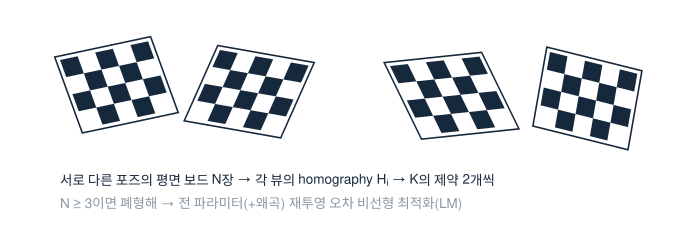

# 9. 카메라 캘리브레이션 — Zhang · 1D 타깃 · Ray

> 평면 보드 N장으로 $K$·왜곡·포즈를 전부 푸는 표준 해법(Zhang)부터, 막대 하나로 푸는 1D 타깃, 모델 자체를 버리는 ray calibration까지 — **수식을 한 줄씩 전개**한다. 논문 단위 리뷰는 [1D](../reviews/1d-calibration.md)·[ray](../reviews/ray-calibration.md)에 따로 있고, 이 페이지는 유도 자체를 다룬다.

## 1. Zhang 캘리브레이션 — 전체 전개

### 1.1 출발점 — 보드 평면을 $Z=0$으로 두면 호모그래피가 남는다

보드 위 점은 $(X, Y, 0)$이므로 투영식에서 $R$의 셋째 열이 통째로 죽는다:

$$ s\,\tilde{\mathbf m} = K\,[\mathbf r_1\ \mathbf r_2\ \mathbf r_3\ \mathbf t]\begin{bmatrix}X\\Y\\0\\1\end{bmatrix}
= \underbrace{K\,[\mathbf r_1\ \mathbf r_2\ \mathbf t]}_{\textstyle H}\begin{bmatrix}X\\Y\\1\end{bmatrix} $$

즉 보드↔이미지는 3×3 호모그래피 $H = [\mathbf h_1\ \mathbf h_2\ \mathbf h_3]$이고, 뷰마다 [4장](homography.md)의 DLT로 $H$를 추정할 수 있다. 스케일 모호를 $\lambda$로 명시하면:

$$ [\mathbf h_1\ \mathbf h_2\ \mathbf h_3] = \lambda\, K\,[\mathbf r_1\ \mathbf r_2\ \mathbf t]
\quad\Longrightarrow\quad
\mathbf r_1 = \tfrac{1}{\lambda}K^{-1}\mathbf h_1,\qquad \mathbf r_2 = \tfrac{1}{\lambda}K^{-1}\mathbf h_2 $$

### 1.2 제약의 탄생 — $\mathbf r_1, \mathbf r_2$는 회전행렬의 열이다

회전행렬의 열은 **단위 벡터이고 서로 직교**한다. 이 두 사실을 위 식에 대입한다:

$$ \mathbf r_1^\top \mathbf r_2 = 0
\;\Longrightarrow\;
\mathbf h_1^\top \underbrace{K^{-\top}K^{-1}}_{\textstyle \omega}\, \mathbf h_2 = 0 $$

$$ \|\mathbf r_1\| = \|\mathbf r_2\|
\;\Longrightarrow\;
\mathbf h_1^\top \omega\, \mathbf h_1 = \mathbf h_2^\top \omega\, \mathbf h_2 $$

($\lambda$는 양변에서 약분된다 — 그래서 norm의 "값"이 아니라 "같음"만 쓸 수 있고, 뷰당 제약이 3개가 아니라 **2개**다.) $\omega = K^{-\top}K^{-1}$는 image of the absolute conic(IAC) — 이름은 사영기하에서 오지만, 실용적으로는 **"$K$만의 함수인 대칭 행렬"**이면 충분하다.

### 1.3 선형화 — $\omega$를 6-벡터로 펴기

$\omega$는 대칭 3×3이므로 독립 원소 6개: $\mathbf b = (\omega_{11}, \omega_{12}, \omega_{22}, \omega_{13}, \omega_{23}, \omega_{33})^\top$. 이차형식 $\mathbf h_i^\top \omega\, \mathbf h_j$를 전개하면 $\mathbf b$에 대해 **선형**이다:

$$ \mathbf h_i^\top \omega\, \mathbf h_j = \mathbf v_{ij}^\top \mathbf b,\qquad
\mathbf v_{ij} = \big(h_{1i}h_{1j},\ h_{1i}h_{2j}{+}h_{2i}h_{1j},\ h_{2i}h_{2j},\ h_{3i}h_{1j}{+}h_{1i}h_{3j},\ h_{3i}h_{2j}{+}h_{2i}h_{3j},\ h_{3i}h_{3j}\big)^\top $$

뷰 하나가 주는 두 제약을 쌓으면:

$$ \begin{bmatrix}\mathbf v_{12}^\top\\ (\mathbf v_{11}-\mathbf v_{22})^\top\end{bmatrix}\mathbf b = \mathbf 0 $$

뷰 $n$장 → $2n \times 6$ 행렬 $V$에 대해 $V\mathbf b = \mathbf 0$. $\mathbf b$는 스케일 모호(유효 미지수 5)이므로 $2n \ge 5$, 즉 **서로 다른 포즈 3장 이상**이면 SVD 최소특이벡터로 풀린다. (skew $\gamma=0$을 알면 $\omega_{12}=0$이 제약 하나를 더해 2장, 주점까지 알면 1장.) **퇴화 조건**: 보드가 평행 이동만 하면(같은 자세) 새 제약이 안 생긴다 — "다양한 기울임"이 필수인 수학적 이유.

### 1.4 $\omega$에서 $K$를 닫힌 형으로 추출

현대 카메라 표준인 $\gamma = 0$으로 쓰면 ($K = \mathrm{diag}$ 꼴 + 주점):

$$ \omega = K^{-\top}K^{-1} =
\begin{bmatrix}
\frac{1}{\alpha^2} & 0 & -\frac{u_0}{\alpha^2}\\[2pt]
0 & \frac{1}{\beta^2} & -\frac{v_0}{\beta^2}\\[2pt]
-\frac{u_0}{\alpha^2} & -\frac{v_0}{\beta^2} & \frac{u_0^2}{\alpha^2}+\frac{v_0^2}{\beta^2}+1
\end{bmatrix} $$

SVD로 얻은 $\mathbf b$는 이것의 $\lambda$배($B = \lambda\omega$)다. 원소 비(比)는 스케일에 불변이므로 주점부터 벗긴다:

$$ u_0 = -\frac{B_{13}}{B_{11}},\qquad v_0 = -\frac{B_{23}}{B_{22}} $$

스케일은 $(3,3)$ 원소의 "$+1$"이 결정한다 — $\omega_{33}$에서 주점 항을 빼면 1만 남으므로:

$$ \lambda = B_{33} - \frac{B_{13}^2}{B_{11}} - \frac{B_{23}^2}{B_{22}},\qquad
\alpha = \sqrt{\lambda / B_{11}},\qquad \beta = \sqrt{\lambda / B_{22}} $$

(일반 $\gamma \ne 0$ 버전은 Zhang 2000 부록 B — 구조는 동일하고 식만 길다.) 검산 습관: 복원한 $K$로 $\omega$를 다시 만들어 $B/\lambda$와 비교하면 부호·전개 실수가 즉시 드러난다.

### 1.5 각 뷰의 extrinsic 추출

$K$를 알면 1.1의 식이 그대로 포즈를 준다:

$$ \lambda = \frac{1}{\|K^{-1}\mathbf h_1\|},\qquad
\mathbf r_1 = \lambda K^{-1}\mathbf h_1,\quad
\mathbf r_2 = \lambda K^{-1}\mathbf h_2,\quad
\mathbf r_3 = \mathbf r_1 \times \mathbf r_2,\quad
\mathbf t = \lambda K^{-1}\mathbf h_3 $$

노이즈 때문에 $[\mathbf r_1\ \mathbf r_2\ \mathbf r_3]$는 정확한 회전행렬이 아니다 — SVD로 $R = UV^\top$ ("가장 가까운 회전행렬"로 사영)해 둔다. 부호는 $\det R = +1$과 보드가 카메라 앞($t_z>0$)이라는 물리로 고정.

### 1.6 왜곡 초기화 — 선형 최소제곱

방사 왜곡 2차까지, 정규화 좌표 반경 $r^2$에 대해 이상적 픽셀 $(u,v)$와 관측 $(\breve u, \breve v)$의 관계:

$$ \breve u = u + (u - u_0)(k_1 r^2 + k_2 r^4),\qquad
\breve v = v + (v - v_0)(k_1 r^2 + k_2 r^4) $$

현재 추정(K·포즈)으로 $(u, v, r)$을 계산할 수 있으므로, 점 하나가 $k_1, k_2$에 대한 **선형식 2개**를 준다:

$$ \begin{bmatrix}(u-u_0)r^2 & (u-u_0)r^4\\ (v-v_0)r^2 & (v-v_0)r^4\end{bmatrix}
\begin{bmatrix}k_1\\ k_2\end{bmatrix} =
\begin{bmatrix}\breve u - u\\ \breve v - v\end{bmatrix} $$

전 관측을 쌓아 $D\mathbf k = \mathbf d$, $\mathbf k = (D^\top D)^{-1}D^\top \mathbf d$. 여기까지가 전부 **폐형(closed-form) 초기화**다.

### 1.7 진짜 답 — MLE를 Levenberg–Marquardt로

가우시안 관측 노이즈 가정에서 MLE는 전체 재투영 오차 최소화다:

$$ \min_{\boldsymbol\theta}\ \sum_{i=1}^{n}\sum_{j=1}^{m}
\big\| \mathbf x_{ij} - \pi(K, \mathbf k, R_i, \mathbf t_i, \mathbf X_j) \big\|^2,\qquad
\boldsymbol\theta = (\underbrace{\alpha,\beta,u_0,v_0}_{K},\ \underbrace{k_1,k_2}_{\text{왜곡}},\ \underbrace{\{\boldsymbol\rho_i, \mathbf t_i\}}_{\text{뷰당 }6}) $$

전개를 한 줄씩:

1. **회전 파라미터화**: $R_i$를 9원소로 두면 직교 제약 6개를 끌고 다녀야 한다. **Rodrigues 벡터 $\boldsymbol\rho_i \in \mathbb{R}^3$** ($R = \exp([\boldsymbol\rho]_\times)$)로 두면 제약이 공짜고 최소 파라미터다. 매 반복에서 접공간 증분을 풀고 exp로 복귀하는 매니폴드 갱신과 수치적으로 동등.
2. **잔차와 야코비안**: 잔차 벡터 $\mathbf r(\boldsymbol\theta) \in \mathbb{R}^{2nm}$, $J = \partial \mathbf r / \partial \boldsymbol\theta$. 투영 $\pi$는 (회전→병진→정규화→왜곡→K) 합성이라 체인룰 블록 곱으로 닫힌 형이 나온다.
3. **Gauss–Newton**: 2차 테일러에서 residual의 2차 도함수 항을 버리면 $J^\top J\,\boldsymbol\delta = -J^\top \mathbf r$. 수렴 근방에선 빠르지만(준 2차), 초기값이 멀면 $J^\top J$가 악조건일 때 발산.
4. **LM = 댐핑 넣은 GN**:

   $$ (J^\top J + \mu\,\mathrm{diag}(J^\top J))\,\boldsymbol\delta = -J^\top \mathbf r $$

   $\mu \to 0$이면 GN, $\mu \to \infty$면 작은 경사하강 스텝 — **"믿을 수 있을 때는 2차, 아닐 때는 1차"를 $\mu$ 하나로 보간**한다. 갱신이 비용을 줄이면 $\mu$를 낮추고(공격적으로), 늘리면 스텝을 버리고 $\mu$를 올린다(보수적으로). 신뢰영역(trust region)의 라그랑주 형태로 읽어도 같다.
5. **희소성**: $J^\top J$는 화살촉(arrowhead) 구조다 — intrinsic·왜곡 열은 모든 잔차에 걸리지만 $(R_i, \mathbf t_i)$ 열은 **뷰 $i$의 잔차에만** 걸린다. 뷰 블록을 Schur 보수로 먼저 소거하면 뷰 수에 선형으로 풀린다 — [번들 조정](epipolar.md)과 같은 구조이고, 보드 좌표가 월드로 고정돼 있어 게이지 모호가 없다는 점만 다르다.
6. 보고되는 **재투영 RMS**가 이 목적함수의 최종값이다. 폐형해(1.3~1.6)는 이 비선형 문제의 **초기값 공급자**일 뿐 — 역할 분담을 섞지 않는 것이 Zhang 설계의 요체다.

## 2. 1D 타깃 캘리브레이션 — 전체 전개 (Zhang 2004)

막대 하나(공선점 3개, 한 점 고정)로 $K$를 푸는 문제. "왜 자유 이동은 안 되고 고정점 회전이면 되는가"의 자유도 회계는 [리뷰](../reviews/1d-calibration.md)의 표를 보고, 여기서는 **되는 경우의 유도**를 한 줄씩 간다.

### 2.1 설정

- 고정점 $A$, 자유 끝 $B$, 길이 $\|B - A\| = L$ 기지.
- 내분점 $C = \lambda_A A + \lambda_B B$ — 막대 위 위치가 알려져 있으므로 $\lambda_A, \lambda_B$ 기지 (예: 중점이면 $\tfrac12, \tfrac12$).
- 카메라 좌표계에서 물체를 정의한다($R{=}I, t{=}0$ — 1D는 자체 좌표계를 세울 수 없으므로 이 선택이 자연스럽다). 관측 이미지점(동차) $\tilde{\mathbf a}, \tilde{\mathbf b}, \tilde{\mathbf c}$, 미지 깊이 $z_A, z_B, z_C$:

$$ A = z_A K^{-1}\tilde{\mathbf a},\qquad B = z_B K^{-1}\tilde{\mathbf b},\qquad C = z_C K^{-1}\tilde{\mathbf c} $$

$z_A$는 고정점이므로 **모든 프레임 공통**, $z_B$는 프레임마다 다르다.

### 2.2 공선성으로 $z_C$ 소거

$C = \lambda_A A + \lambda_B B$에 위를 대입하고 양변에 $K$를 곱하면 ($K^{-1}$이 전부 소거):

$$ z_C\,\tilde{\mathbf c} = z_A \lambda_A\,\tilde{\mathbf a} + z_B \lambda_B\,\tilde{\mathbf b} $$

양변에 $\tilde{\mathbf c}$와의 외적을 취하면 $\tilde{\mathbf c} \times \tilde{\mathbf c} = \mathbf 0$이라 $z_C$가 사라진다:

$$ z_A \lambda_A (\tilde{\mathbf a} \times \tilde{\mathbf c}) + z_B \lambda_B (\tilde{\mathbf b} \times \tilde{\mathbf c}) = \mathbf 0 $$

### 2.3 내적으로 $z_B$를 $z_A$의 함수로

위 벡터 방정식에 $(\tilde{\mathbf b} \times \tilde{\mathbf c})$를 내적하면 스칼라 하나가 남는다:

$$ z_B = -z_A\,\frac{\lambda_A\,(\tilde{\mathbf a} \times \tilde{\mathbf c})\cdot(\tilde{\mathbf b} \times \tilde{\mathbf c})}{\lambda_B\,(\tilde{\mathbf b} \times \tilde{\mathbf c})\cdot(\tilde{\mathbf b} \times \tilde{\mathbf c})} $$

즉 **프레임마다 새로 생기는 미지수 $z_B$는 관측만으로 $z_A$에 묶인다.** 이것이 고정점 설정의 수학적 이득이다 — 미지수 증가 속도(프레임당 2: 막대 방향)보다 방정식 증가 속도가 빨라진다.

### 2.4 길이 제약 — $\omega$에 대한 선형식 하나

$$ \|B - A\| = \|K^{-1}(z_B \tilde{\mathbf b} - z_A \tilde{\mathbf a})\| = L $$

2.3을 대입해 $z_B = z_A \cdot (\text{관측비})$로 치환하면:

$$ z_A \|K^{-1}\mathbf h\| = L,\qquad
\mathbf h = \tilde{\mathbf a} + \frac{\lambda_A (\tilde{\mathbf a}\times\tilde{\mathbf c})\cdot(\tilde{\mathbf b}\times\tilde{\mathbf c})}{\lambda_B (\tilde{\mathbf b}\times\tilde{\mathbf c})\cdot(\tilde{\mathbf b}\times\tilde{\mathbf c})}\,\tilde{\mathbf b} $$

($\mathbf h$는 순수하게 이미지 관측과 기지 비율만의 함수 — 프레임마다 계산 가능한 벡터다.) 제곱하면 Zhang 평면식과 **같은 행렬** $\omega = K^{-\top}K^{-1}$가 등장한다:

$$ z_A^2\, \mathbf h^\top \omega\, \mathbf h = L^2 $$

### 2.5 선형계로 풀기

1.3과 동일하게 $\omega$를 6-벡터 $\mathbf b$로 펴고, 미지 스케일을 흡수해 $\mathbf x = z_A^2\,\mathbf b$로 두면 프레임당 **비동차 선형식 하나**:

$$ \mathbf v^\top \mathbf x = L^2,\qquad \mathbf v = \mathbf v(\mathbf h) \text{는 } \mathbf v_{ij} \text{와 같은 전개} $$

미지수 6개($\mathbf x$) → **관측(막대 자세) 6회 이상**이면 최소제곱으로 $\mathbf x$가 나온다. 평면 보드와의 대비: 뷰당 제약 2개 vs **자세당 1개** — 1D가 정보 밀도에서 지는 이유가 숫자로 보인다.

### 2.6 $\mathbf x$에서 $K$와 $z_A$ 추출

$\mathbf x = z_A^2\,\mathrm{vec}(\omega)$는 1.4의 $B = \lambda\omega$와 **완전히 같은 구조**다 — $\lambda$ 자리에 $z_A^2$가 앉아 있을 뿐. 그래서 같은 추출식이 그대로 돈다 ($\gamma=0$):

$$ u_0 = -\frac{x_{13}}{x_{11}},\quad v_0 = -\frac{x_{23}}{x_{22}},\quad
z_A^2 = x_{33} - \frac{x_{13}^2}{x_{11}} - \frac{x_{23}^2}{x_{22}},\quad
\alpha = \sqrt{z_A^2/x_{11}},\quad \beta = \sqrt{z_A^2/x_{22}} $$

여기서 1D의 특별한 보너스 — **스케일 인자가 물리량($z_A$: 고정점 깊이)이라 공짜로 복원**되고, 2.3으로 각 프레임의 $z_B$, 2.2로 $z_C$까지 전부 미터 단위로 나온다. 평면 캘리브레이션의 $\lambda$가 버려지는 것과 대조적이다.

### 2.7 MLE 정제

폐형해를 초기값으로, 세 점의 재투영 오차를 최소화한다:

$$ \min\ \sum_{n}\sum_{p\in\{A,B,C\}} \|\mathbf x_{p,n} - \pi(K,\ A,\ \phi_n, \theta_n)\|^2 $$

파라미터는 $K$(5) + 고정점 $A$(3) + **프레임당 막대 방향 2**(구면각 $\phi_n, \theta_n$ — $B = A + L\,\mathbf d(\phi,\theta)$) = $8 + 2N$. LM은 1.7과 동일하게 돌고, 야코비안 희소 구조도 동일(방향각 열은 프레임 국소). 원 논문 실측은 폐형해 오차가 크고(노이즈 민감) MLE로 절반쯤 줄어든다 — **선형해는 여기서도 초기값일 뿐**이라는 같은 교훈.

## 3. Ray calibration — 모델을 버린 캘리브레이션의 수식

핀홀+다항 왜곡이 "모델"이라면, ray calibration은 **픽셀마다 광선을 직접 측정**한다. [리뷰](../reviews/ray-calibration.md)의 VRC(Bartsch 2021) 수식을 유도 수준으로 전개한다.

### 3.1 모델 — 픽셀당 직선 4 파라미터

픽셀 $m$의 vision ray를 기준 평면 $z=0$의 시작점과 기울기로 쓴다 (2-평면 파라미터화):

$$ \mathbf r_m(z) = \big(x_{m0} + u_m z,\ \ y_{m0} + v_m z,\ \ z\big) $$

픽셀당 자유도 4. 핀홀 카메라는 "모든 광선이 한 점(투영 중심)을 지난다"는 **추가 제약이 걸린 특수 사례**다 — 이 제약을 안 거는 것이 일반(generic/non-central) 모델이고, 국소 왜곡·비중심 광학계가 전부 표현된다. 대가: 외삽 불가(관측 안 된 픽셀·영역의 광선은 모른다), 파라미터 수가 픽셀 수에 비례.

### 3.2 관측 — 픽셀당 3D 점열

LCD에 위상 시프트 패턴을 띄우면 각 픽셀 $m$이 포즈 $n$에서 바라보는 **디스플레이 위 좌표**가 dense하게 나온다. 디스플레이 점을 포즈 $(R_n, \mathbf t_n)$로 월드에 놓으면 픽셀당 3D 점열 $\mathbf p_{m,n}$ — 참인 광선 위에 있어야 할 점들이다. **코너 수십 개가 아니라 픽셀 수만큼의 대응**이 나온다는 게 이 관측 방식의 존재 이유다.

### 3.3 비용 — 공선성 그 자체

$$ \Delta = \sum_m \Delta_m,\qquad
\Delta_m = \sum_n \Big[ \big(x_{m,n} - x_{m0} - u_m z_{m,n}\big)^2 + \big(y_{m,n} - y_{m0} - v_m z_{m,n}\big)^2 \Big] $$

$z$ 성분 잔차는 파라미터화 상 항상 0이라 $x, y$만 남는다. 미지수는 광선 $4M$개 + 포즈 $6(N-1)$개(+타깃 형상 계수) — 픽셀이 수십만이면 이대로는 거대하다.

### 3.4 핵심 트릭 — 광선 파라미터를 해석적으로 소거

고정된 $m$에 대해 $\Delta_m$은 **$z \mapsto x$의 1차원 직선 피팅 두 개**(x축, y축)일 뿐이다. 중심화 좌표 $\hat x = x - \langle x\rangle_n$, $\hat z = z - \langle z\rangle_n$를 쓰면:

1. $\partial \Delta_m / \partial x_{m0} = 0 \;\Rightarrow\; x_{m0} = \langle x\rangle - u_m \langle z\rangle$ — **최적 직선은 점열의 무게중심을 지난다.** 시작점 소거.
2. $\partial \Delta_m / \partial u_m = 0 \;\Rightarrow\;$ 1D 최소제곱 기울기 공식:

$$ u_m = \frac{\langle \hat x \hat z\rangle_n}{\langle \hat z^2\rangle_n},\qquad
v_m = \frac{\langle \hat y \hat z\rangle_n}{\langle \hat z^2\rangle_n} $$

(공분산/분산 — 회귀 기울기와 같은 식이다.) 이를 다시 대입하면:

$$ \Delta_m = N\Big( \langle\hat x^2\rangle - \tfrac{\langle\hat x\hat z\rangle^2}{\langle\hat z^2\rangle} \Big) + (y\text{ 항 동형}) $$

— **광선 파라미터가 비용에서 완전히 사라지고, $\Delta$는 포즈(와 타깃 형상 계수)만의 함수**가 된다. 미지수 수십만 → 수백. 포즈·형상에 대한 도함수는 회전행렬 미분뿐이라 gradient와 Hessian이 손으로 닫히고, 그 덕에 dense 관측의 최적화가 실용 시간에 돈다.

### 3.5 게이지 고정과 최소 관측 수

- 공선성은 강체변환에 불변이므로 전체 해가 좌표계 선택만큼 모호하다 — **포즈 하나($T_1$)를 고정**해야 유일해 (번들 조정의 게이지 고정과 같은 이유).
- **최소 포지션 수**: 직선 하나를 정하려면 점 2개가 필요하므로, 포즈를 아는 타깃이면 **2 포지션**. 포즈 미지면 미지수(포즈)가 늘어 **평면 타깃 3 포지션**이 최소(Sturm & Ramalingam의 generic calibration 결과). 1 포지션(화면 고정)이면 픽셀당 점 1개 — 광선 방향을 독립으로 정할 수 없고, 핀홀을 **가정해야만** 풀린다. "화면을 고정했는가"라는 질문이 곧 "ray였는가 파라메트릭이었는가"를 가르는 이유.
- 왜 계측에서 이기나: 핀홀+다항식이 남기는 체계적 잔차(공간 패턴)는 픽셀 bias로 작동하고, **bias는 삼각측량에서 작업거리만큼 증폭**된다 — 0.05 px bias가 2 m에서 수 mm가 되는 산수. 랜덤 노이즈는 평균으로 죽지만 bias는 안 죽는다.

## 4. 세 방법의 자리 — 언제 무엇을

| | Zhang (2D 평면) | 1D 타깃 | Ray (generic) |
|---|---|---|---|
| 타깃 | 체커보드 | 공선점 3+ 막대(한 점 고정) | 디스플레이(위상 시프트) |
| 자세당 제약 | 2 | 1 | 픽셀 수만큼의 대응 |
| 최소 관측 | 3 뷰 ($\gamma{=}0$이면 2) | 6 자세 | 기지 2 / 미지 3 포지션 |
| 모델 | 핀홀+다항 왜곡 | 핀홀+다항 왜곡 | **무모델**(픽셀별 광선) |
| 강점 | 표준·정확·도구 성숙 | 멀티카메라 동시 가시성 | 국소 왜곡·비중심·계측 정밀 |
| 약점 | 대형 FOV 타깃 제작 | 정보 밀도 낮음·고정점 안정성 | 외삽 불가·장치 의존 |

공통 패턴 세 개를 뽑으면 — ① **$\omega = K^{-\top}K^{-1}$에 선형 제약을 모은다**(Zhang·1D가 같은 뼈대), ② **폐형해는 초기값, 답은 재투영 MLE+LM**, ③ **정보는 타깃이 아니라 "자세 다양성"에서 온다**(평행 자세는 퇴화). 면접에서 어떤 캘리브레이션 질문이 와도 이 세 문장으로 돌아오면 된다.

## 5. 품질을 지배하는 것 — 실측에서 배운 순서

1. **코너/대응 검출 품질**: 서브픽셀 정밀도·초점·블러. 흔들린 한 장이 전체를 오염시킨다 → 뷰별 잔차로 이상 뷰를 걸러라.
2. **포즈 다양성**: 기울임이 없으면 $f$와 $Z$가 분리되지 않는다(1.3의 퇴화). 비슷한 정면 샷 20장 < 다양한 기울임 8장.
3. **가장자리 커버**: 왜곡 파라미터는 가장자리 데이터가 결정한다.
4. **과적합 관리**: [8장](distortion.md)의 차수 원칙 그대로.

내 실측: 시뮬 검증에서 fx/fy 오차 ~0.6%, 재투영 RMS 0.37 px — GT가 있는 환경에서 위 요인들을 하나씩 끄고 켜며 확인했다.
